<div align="center">
  <p><sub>CAPE TOWN, SOUTH AFRICA &nbsp;·&nbsp; SOFTWARE &amp; CLOUD ENGINEERING PORTFOLIO</sub></p>
  <h1>Alice Matarise</h1>
  <p><strong>Software Engineering Student &nbsp;|&nbsp; Aspiring Cloud Engineer &nbsp;|&nbsp; Technical Problem Solver</strong></p>
  <p>
    Final-year <strong>BSc Information Technology (Software Engineering)</strong> student at <strong>Eduvos, Cape Town</strong> (2023 – May 2027) building full-stack web applications, deterministic relational databases, native Android software, and serverless cloud infrastructure.
  </p>
  <p>
    <a href="https://cloud-resume-challenge-six.vercel.app/"><strong>Explore Live Portfolio ↗</strong></a>
    &nbsp;&nbsp;·&nbsp;&nbsp;
    <a href="https://github.com/SimplyAlice"><strong>GitHub (@SimplyAlice) ↗</strong></a>
    &nbsp;&nbsp;·&nbsp;&nbsp;
    <a href="https://www.linkedin.com/in/alice-matarise-778bb6374/"><strong>LinkedIn ↗</strong></a>
    &nbsp;&nbsp;·&nbsp;&nbsp;
    <a href="assets/documents/Alice-Matarise-CV.pdf"><strong>Curriculum Vitae (PDF) ↓</strong></a>
  </p>
  <p>
    <a href="https://cloud-resume-challenge-six.vercel.app/">
      
    </a>
  </p>
  <p>
    <sub><strong>Soft Power: Organic Growth Meets Technical Architecture</strong> — pairing expressive, human-centred interfaces with deterministic backend invariants, transactional concurrency safety, and verifiable cloud operations.</sub>
  </p>
</div>

---

## Editorial Direction & Career Trajectory

Good engineering does not end when a build passes on `localhost`. Across my academic projects, collaborative startup engineering, and cloud deployments, I focus on how software behaves under real operational conditions: database row locking, floating-point vs. fixed-point financial precision, TLS connection pooling, browser cache invalidation, and cryptographic file verification.

| Dimension | Focus |
| :--- | :--- |
| **Academic Foundation** | **BSc Information Technology (Software Engineering)** · Eduvos, Cape Town (`2023 – Expected May 2027`) |
| **Cloud Training** | **AWS Skills Center Cape Town** (*Becoming a Cloud Practitioner*, Sep 2026) · Active **Microsoft Azure AZ-900** preparation (`AZ-104` planned next) |
| **Career Pathway** | **Cloud Support &amp; Technical Operations** → **Cloud Engineering** → **Technical Project Management** |
| **Core Philosophy** | **01 · Systems Over Surfaces** (authoritative backend invariants) &nbsp;·&nbsp; **02 · Empirical Troubleshooting** (`SHA-256` &amp; HTTP diagnostics) &nbsp;·&nbsp; **03 · Honest Engineering** (clear separation between shipped production, active remediation, and planned scope) |

### Visual Motif — Two Independent Scroll-Controlled Studies

On the [live portfolio](https://cloud-resume-challenge-six.vercel.app/), the visual identity alternates between warm ivory daylight sections and two completely separate, scroll-scrubbed `video.currentTime` experiences separated by the first wave of engineering case studies:

<table>
  <tr>
    <td width="34%" align="center" valign="top">
      <br>
      <sub><strong>Plate 00 · Landing Hero</strong><br>Warm ivory opening composition pairing botanical form with Fibonacci construction lines and live <code>GET /api/visitors</code> telemetry.</sub>
    </td>
    <td width="33%" align="center" valign="top">
      <br>
      <sub><strong>Study I · Deep Plum Studio (<code>#video-one</code>)</strong><br>Standalone <code>3.92s</code> scroll-scrubbed study where outer petals part as orthogonal architectural elevations illuminate behind the bloom.</sub>
    </td>
    <td width="33%" align="center" valign="top">
      <br>
      <sub><strong>Study II · Warm Parchment Split-Screen (<code>#video-two</code>)</strong><br>Standalone <code>9.96s</code> right-side split-screen study calibrating organic experimentation into radial protractors and system contracts.</sub>
    </td>
  </tr>
</table>

---

## Featured Engineering Projects

Each project below reflects its verified repository state, real user interface captures, animated workflow demonstrations, and system architecture diagrams.

---

### 01 · Dayform — Context-Aware Cape Town Outing &amp; Itinerary Engine

**Status:** Frontend Live on Vercel (`HTTP 200`) · Backend Domain Verified (`98` Pytest Modules + `4` Vitest Suites) · Hosted Render API / Neon `asyncpg` Pooler Handshake in Active Remediation  
**Links:** [Live Frontend (Vercel) ↗](https://dayform-live.vercel.app/) &nbsp;·&nbsp; [GitHub Repository (`SimplyAlice/dayform`) ↗](https://github.com/SimplyAlice/dayform)

Dayform turns freeform natural-language outing prompts (*"Lunch somewhere pretty in the Southern Suburbs under R500"* or *"A relaxed rainy-day coffee and gallery afternoon"*) into time-sequenced, weather-aware, Rands-bounded Cape Town itineraries with paced transit buffers and RFC-5545 `.ics` calendar export.

<div align="center">
  <a href="https://dayform-live.vercel.app/">
    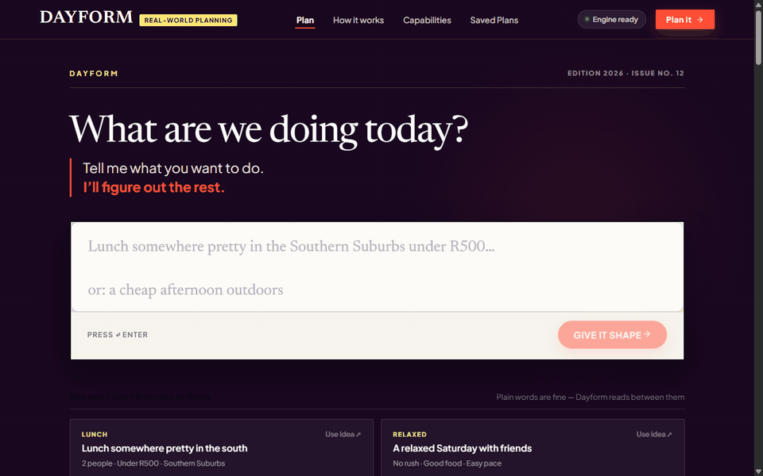
  </a>
  <br>
  <sub><strong>Animated UI Walkthrough (<code>dayform-walkthrough.gif</code>):</strong> Natural-language prompt entry → Stage 02 context &amp; constraint extraction → Stage 04 sequenced Cape Town itinerary (Truth Coffee → Zeitz MOCAA → Honest Chocolate) → Stage 05 live constraint recalibration.</sub>
</div>

<br>

<table>
  <tr>
    <td width="50%" align="center" valign="top">
      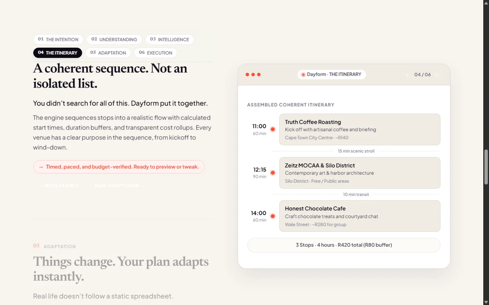<br>
      <sub><strong>Sequenced Itinerary View:</strong> Timed stops, ZAR cost breakdown, and Cape Town neighbourhood routing.</sub>
    </td>
    <td width="50%" align="center" valign="top">
      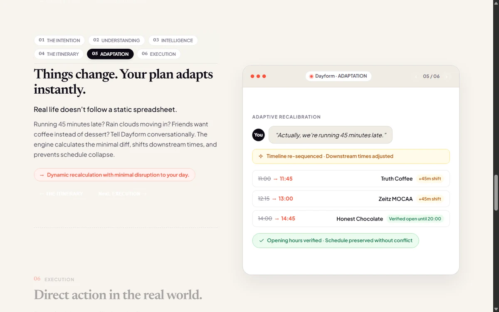<br>
      <sub><strong>Adaptive Recalibration:</strong> Non-destructive schedule diffs when weather windows or timing constraints shift.</sub>
    </td>
  </tr>
</table>

<div align="center">
  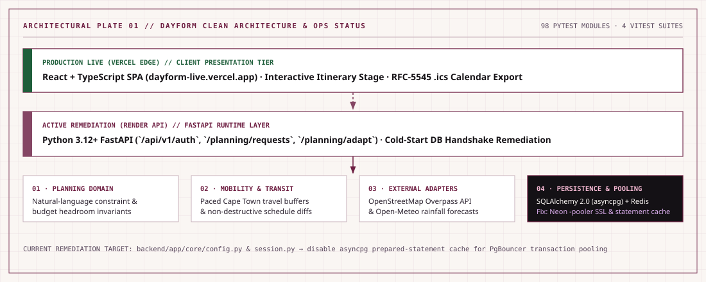
  <br>
  <sub><strong>Architectural Plate 01 (<code>dayform-architecture.svg</code>):</strong> Separation between the live Vercel React + TypeScript presentation tier, the FastAPI domain engine, external OSM Overpass &amp; Open-Meteo adapters, and the active Render/Neon <code>asyncpg</code> connection-pooling remediation.</sub>
</div>

#### Technical Implementation &amp; Operational Transparency

- **Technology Stack:** React 18, TypeScript, Vite, Python 3.12+, FastAPI, PostgreSQL 15+, SQLAlchemy 2.0 (`asyncpg`), Alembic, Redis 7+, OpenStreetMap Overpass API, Open-Meteo API, Vercel, Render.
- **Implemented &amp; Tested:**
  - **98 backend Pytest test modules** + **4 frontend Vitest suites** covering natural-language constraint extraction, budget headroom invariants, mobility/transit buffer calculation, weather window scoring, authentication, and RFC-5545 `.ics` export.
  - **Live Frontend SPA:** Deployed on Vercel at [dayform-live.vercel.app](https://dayform-live.vercel.app/) with interactive story stages and planning views.
- **Currently in Remediation (Production Backend Connectivity):**
  - While the React SPA serves live on Vercel (`HTTP 200`), the hosted Render FastAPI service (`dayform-api.onrender.com`) is undergoing active remediation for `asyncpg` SSL/TLS negotiation and PgBouncer transaction-pooler prepared-statement caching against Neon's `-pooler` endpoint (`resolve_asyncpg_connect_config`, `statement_cache_size=0`, and `pool_recycle`).

---

### 02 · Zazen Matcha &amp; Tea Co. — Bespoke PHP 8 E-Commerce &amp; SSH Production Operations

**Status:** Production Deployed on Alwaysdata (`HTTP 200`) · Active Local Working-Tree Refinements for Chawan Sequence &amp; Backup Automation  
**Links:** [Live Storefront (Alwaysdata) ↗](https://zazen-matcha.alwaysdata.net/) &nbsp;·&nbsp; [GitHub Repository (`SimplyAlice/Zazen-Matcha`) ↗](https://github.com/SimplyAlice/Zazen-Matcha)

A custom-engineered e-commerce platform and ceremonial matcha experience built from first principles in **PHP 8 (`PDO`)** and **MariaDB (`InnoDB`)** without third-party e-commerce frameworks. It combines cultivar and grade filtering, stateful cart management, atomic row-locked checkout transactions, a role-guarded `/admin` CRUD console, and an interactive bamboo *chasen* whisking ritual.

<table>
  <tr>
    <td width="56%" align="center" valign="top">
      <a href="https://zazen-matcha.alwaysdata.net/">
        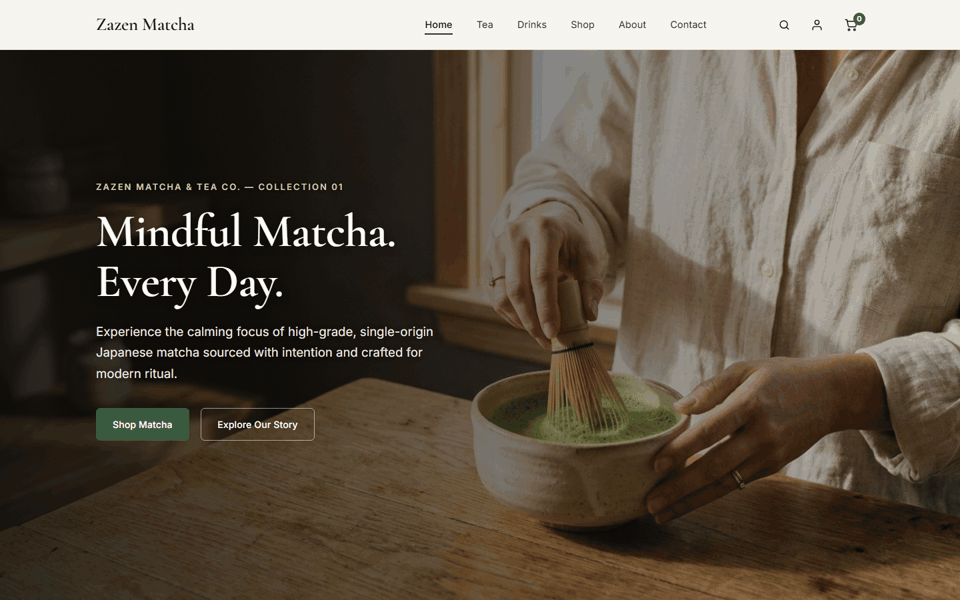
      </a><br>
      <sub><strong>Storefront &amp; Admin Flow (<code>zazen-storefront-flow.gif</code>):</strong> Live customer journey from editorial hero and cultivar filtering through stateful cart, checkout receipt, and <code>/admin</code> inventory CRUD.</sub>
    </td>
    <td width="44%" align="center" valign="top">
      <br>
      <sub><strong>Interactive Chawan Whisking Ritual (<code>matcha-ritual.gif</code>):</strong> Sensory ritual loop driven by <code>js/chawan-sequence.js</code> pairing tactile Uji tea craft with front-end motion control.</sub>
    </td>
  </tr>
</table>

<table>
  <tr>
    <td width="33%" align="center" valign="top">
      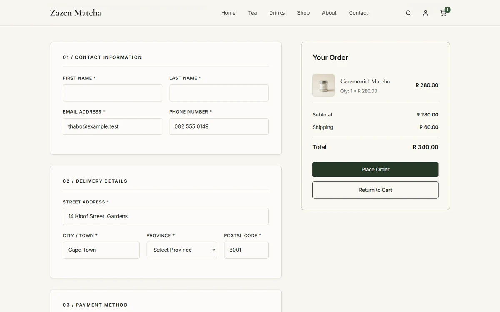<br>
      <sub><strong>Atomic Checkout:</strong> Row-locked stock reservation via <code>SELECT ... FOR UPDATE</code>.</sub>
    </td>
    <td width="33%" align="center" valign="top">
      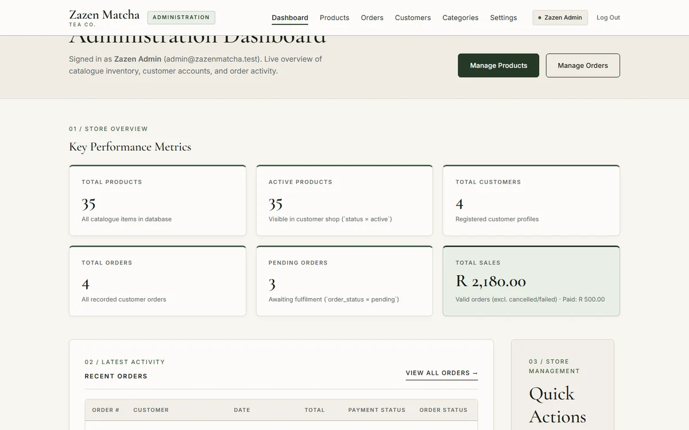<br>
      <sub><strong>Role-Guarded <code>/admin</code> Console:</strong> Product, stock, and order fulfillment management.</sub>
    </td>
    <td width="34%" align="center" valign="top">
      <br>
      <sub><strong>Studio Photography:</strong> Original product imagery mapped to live MariaDB SKU rows.</sub>
    </td>
  </tr>
</table>

<details>
  <summary><strong>Inspect Physical 8-Table 3NF MariaDB Schema (<code>mariadb-eerd.svg</code>)</strong></summary>
  <br>
  <div align="center">
    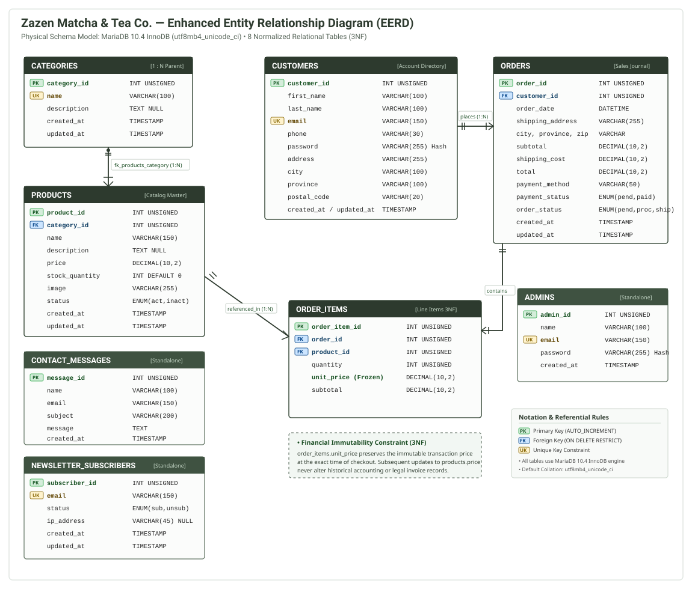
    <br>
    <sub><strong>3NF Relational Schema:</strong> 8 normalized <code>InnoDB</code> tables enforcing foreign-key integrity across users, products, categories, orders, order items, and ritual metadata.</sub>
  </div>
</details>

#### Technical Implementation &amp; Production Operations

- **Technology Stack:** PHP 8, PDO (prepared statements), MariaDB / MySQL (`InnoDB`), Semantic HTML5, CSS Grid, Vanilla JavaScript, Apache, Alwaysdata Linux Hosting, SSH/SCP, PowerShell 7 (`Get-FileHash`).
- **Transactional Concurrency Safety:** `customer/checkout.php` wraps order creation and inventory decrement inside `$pdo->beginTransaction()` using `SELECT ... FOR UPDATE` row-level locks to prevent overselling under concurrent checkouts, paired with `password_hash(..., PASSWORD_BCRYPT)` authentication and `hash_equals()` CSRF token validation.
- **Zero-Data-Loss SSH/SCP Rollouts:** Deployed to Alwaysdata over SSH/SCP while preserving live production database state and server-side `config.php`; resolved aggressive browser caching via asset cache-busting and verified local-to-remote file parity using PowerShell `SHA-256` hashes.

---

### 03 · Quote_Flow — B2B Pricing, Catalogue Ingestion &amp; Margin Intelligence Engine

**Status:** Active Collaborative Development on `Feature/Backend-Foundation` (`179` Passing Unit Tests + `18` PG16 Integration Tests) · Next.js 15 Frontend Planned Post-API Freeze  
**Links:** [GitHub Repository (`SimplyAlice/Quote_Flow`) ↗](https://github.com/SimplyAlice/Quote_Flow) *(No live public URL — backend foundation branch under active development)*

Co-developed with a Data Science graduate (with my role leading Software Engineering &amp; Backend Architecture), **Quote_Flow** is a multi-tenant B2B pricing and quotation engine built for South African solar, electrical, and backup-power contractors. It eliminates spreadsheet drift through strict fixed-point `Decimal` contracts, a 5-tier supplier SKU normalisation hierarchy, append-only supplier price snapshots, and acyclic composite-key quotation revisions.

<div align="center">
  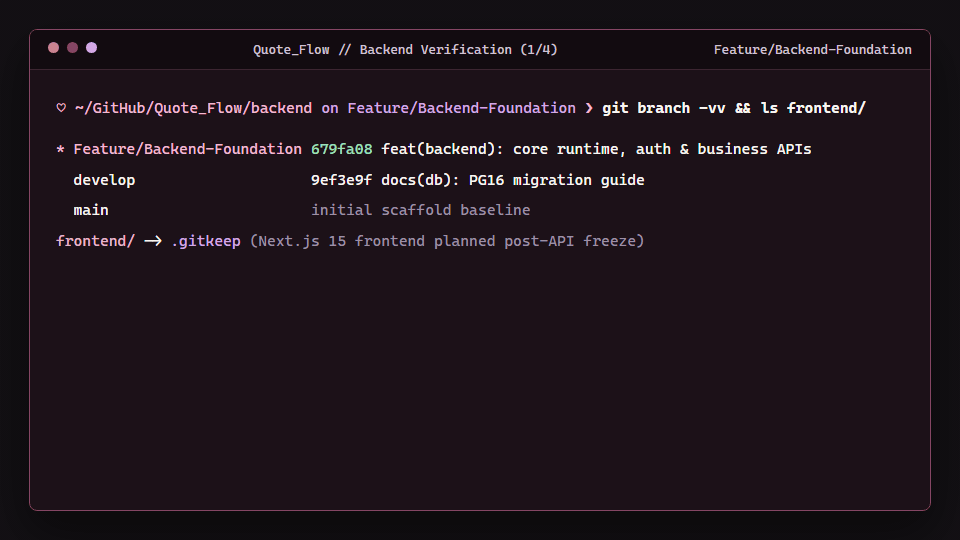
  <br>
  <sub><strong>Empirical Terminal Verification (<code>quoteflow-pytest-run.gif</code>):</strong> Verifies branch <code>Feature/Backend-Foundation</code> (commit <code>679fa08</code>), <code>frontend/.gitkeep</code> scaffold status, Alembic baseline <code>6fe0f6e79dd9</code>, and <code>pytest backend/tests/unit</code> executing <strong>179 passed in 9.57s</strong> across 17 unit test modules.</sub>
</div>

<br>

<div align="center">
  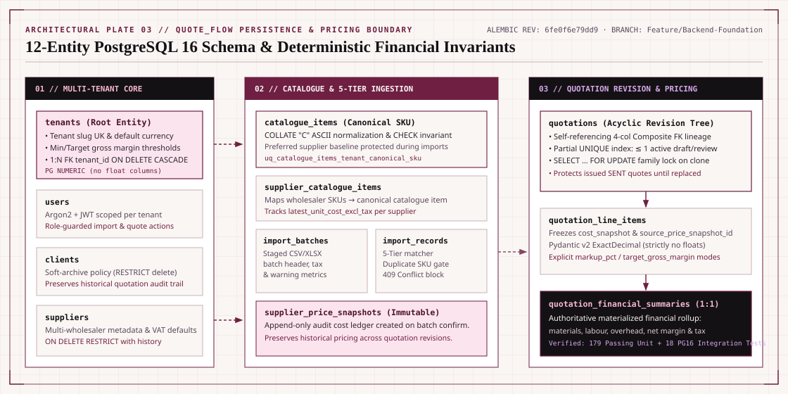
  <br>
  <sub><strong>Architectural Plate 03 (<code>relational-schema.svg</code>):</strong> 12 SQLAlchemy 2.0 ORM entities across multi-tenant isolation, 5-tier catalogue ingestion, immutable <code>supplier_price_snapshots</code>, and self-referencing 4-column composite quotation revision trees.</sub>
</div>

#### Technical Implementation &amp; Scope Boundaries

- **Technology Stack:** Python 3.13, FastAPI, PostgreSQL 16, SQLAlchemy 2.0, Alembic, Pydantic v2 (`ExactDecimal`), Argon2 / JWT Authentication, Docker Compose, Pytest, Ruff *(Next.js 15, TypeScript &amp; Tailwind CSS planned)*.
- **Why IEEE 754 Floats Are Rejected (`ExactDecimal` → `NUMERIC`):**
  - Binary floating-point representation introduces mantissa drift (`0.1 + 0.2 === 0.30000000000000004`), which corrupts VAT, markup, and gross-margin rollups across multi-item contractor quotes.
  - Quote_Flow enforces Pydantic v2 `ExactDecimal` validators at the API boundary (rejecting raw JSON floats with `HTTP 422`) and persists all monetary and percentage columns as PostgreSQL `NUMERIC(14,4)` / `NUMERIC(7,4)` with zero floating-point columns in the schema.
- **5-Tier Supplier SKU Matching &amp; Immutable Revisions:**
  1. **Stage 01 · Canonical ASCII SKU Normalisation (`COLLATE "C"`):** Strips punctuation/whitespace into uppercase ASCII keys constrained by PostgreSQL regex `CHECK` rules.
  2. **Stage 02 · Explicit Supplier Alias Lookup:** Maps wholesaler SKU codes to canonical catalogue items across historical batches.
  3. **Stage 03 · Trigram Similarity &amp; Category Candidate Scoring:** Flags probable matches inside isolated staging batches for human review.
  4. **Stage 04 · Preferred Supplier Baseline Guard:** Prevents lower-confidence CSV/XLSX imports from overwriting approved primary supplier unit costs.
  5. **Stage 05 · 4-Column Composite Quotation Revision Key:** Binds `(tenant_id, quote_group_id, revision_number, id)` to immutable `supplier_price_snapshots` and locks family lineages with `SELECT ... FOR UPDATE` when cloning revisions.
- **Implemented vs. Planned:**
  - **Implemented &amp; Tested (`Feature/Backend-Foundation`):** 12 SQLAlchemy 2.0 ORM models, baseline PostgreSQL 16 Alembic migration (`6fe0f6e79dd9`), 6 core FastAPI v1 routers, Argon2/JWT auth, **17 unit test files (179 passing tests)**, and **10 PostgreSQL 16 integration test files (18 tests)**.
  - **Collaborator Branches &amp; Planned Frontend:** `origin/Feature/Ingestion-Engine` and `origin/develop` integrate supplier CSV/XLSX batch parsing; `frontend/` currently contains `.gitkeep` placeholders only while the Next.js 15 UI is scheduled after API contract freeze.

---

### 04 · Career Connect — Native Kotlin Android Graduate Opportunity Platform

**Status:** Completed Academic 6-Person Agile Prototype · 11 Kotlin Activities · Verified by `26` JUnit 4 Unit Tests  
**Platform:** Android SDK (`API 24–37`) · Kotlin · XML &amp; Material Design · Firebase Auth &amp; Cloud Firestore · Retrofit 2 · `AndroidKeyStore`

Developed by a six-person Agile student team (where I served as Project Leader &amp; Android Developer), **Career Connect** helps South African university graduates discover entry-level local and remote roles, filter opportunities by degree discipline, track application statuses with a 14-day stale-application guard, and store personal CV/profile data encrypted on-device.

<table>
  <tr>
    <td width="38%" align="center" valign="top">
      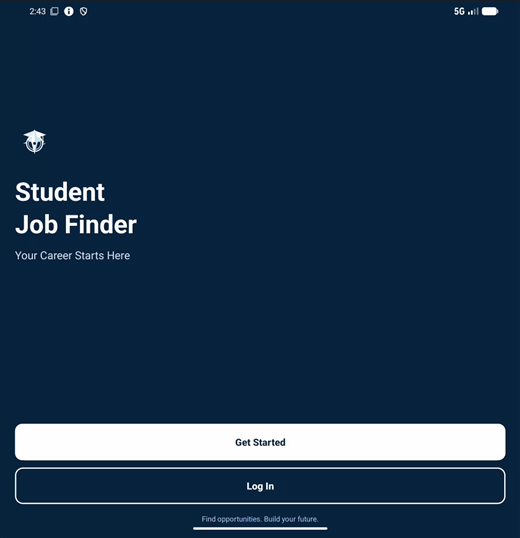<br>
      <sub><strong>13.5s Emulator Walkthrough (<code>app-walkthrough.gif</code>):</strong> End-to-end flow across onboarding, Firebase sign-in, curated SA roles, Remotive live jobs, Firestore tracker, OS notification, CV Builder, and AES-256-GCM profile storage.</sub>
    </td>
    <td width="62%" align="center" valign="top">
      <table>
        <tr>
          <td align="center">
            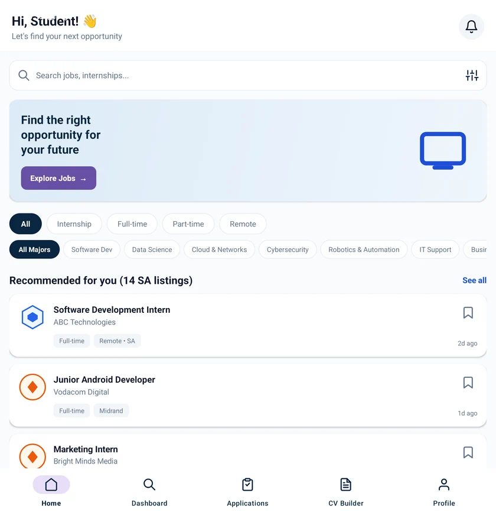<br>
            <sub><strong>03 · Home Feed</strong><br><code>MainActivity.kt</code></sub>
          </td>
          <td align="center">
            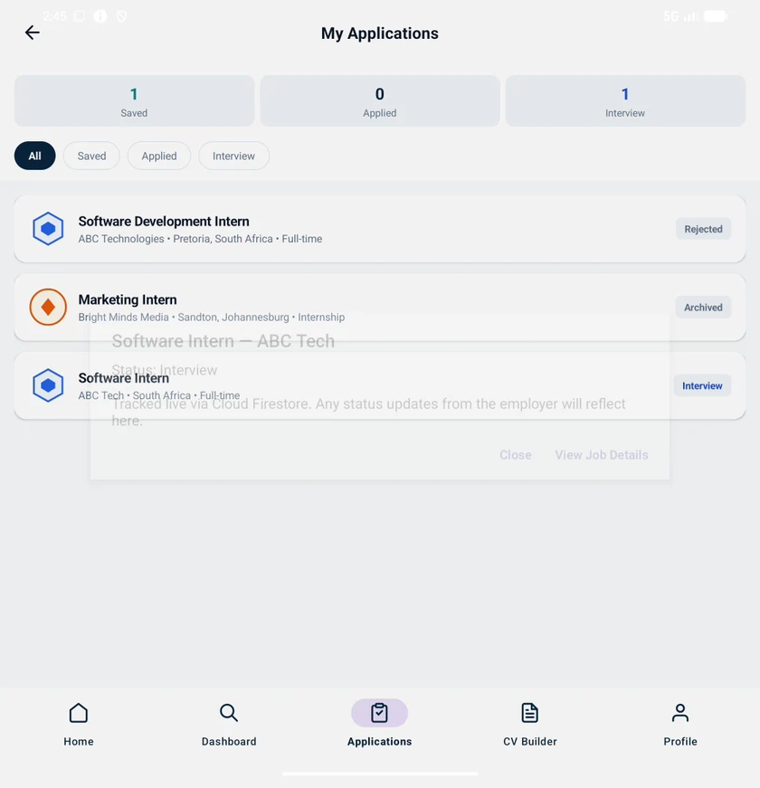<br>
            <sub><strong>07 · Tracker</strong><br><code>ApplicationsActivity.kt</code></sub>
          </td>
          <td align="center">
            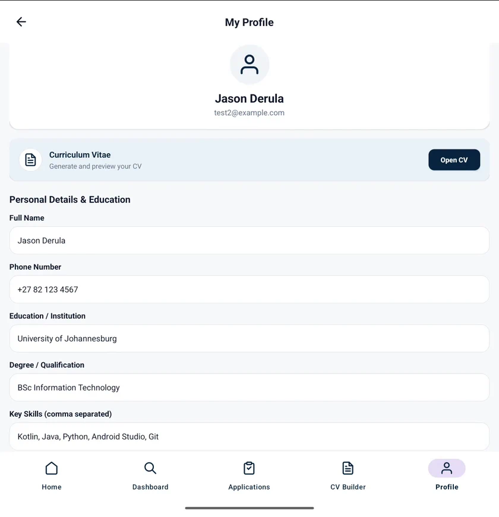<br>
            <sub><strong>10 · AES-256 Profile</strong><br><code>SecureProfileStore.kt</code></sub>
          </td>
        </tr>
      </table>
      <br>
      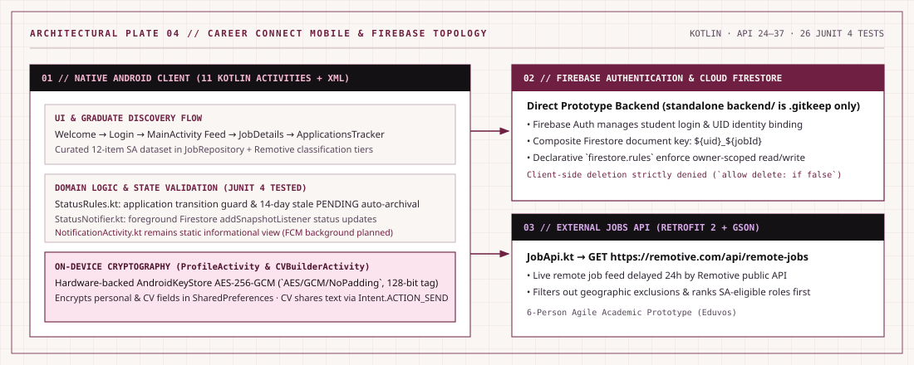<br>
      <sub><strong>Architectural Plate 04 (<code>career-connect-architecture.svg</code>):</strong> Client-to-Firebase security boundaries, Retrofit 2 Remotive feed, and hardware-backed <code>AndroidKeyStore</code> encryption.</sub>
    </td>
  </tr>
</table>

#### Technical Implementation &amp; Prototype Boundaries

- **Technology Stack:** Kotlin, Android SDK (`API 24–37`), XML Layouts &amp; Material Components, Firebase Authentication, Cloud Firestore (`firestore.rules`), Retrofit 2 + Gson (`https://remotive.com/api/remote-jobs`), `AndroidKeyStore` (`AES/GCM/NoPadding`), JUnit 4.
- **Implemented &amp; Tested:**
  - **11 Kotlin Activities** integrating a curated 12-item South African graduate dataset (`JobRepository.kt`) alongside live remote listings via `JobApi.kt`.
  - **Idempotent Firestore Application Tracking:** Uses composite `${uid}_${jobId}` document keys to prevent duplicate submissions, owner-scoped declarative `firestore.rules` (`allow delete: if false`), and a 14-day stale `PENDING` rule verified across **26 JUnit 4 unit tests** (`StatusRulesTest.kt`).
  - **Hardware-Backed On-Device Encryption:** Encrypts sensitive student profile and CV fields locally inside `SharedPreferences` using `AndroidKeyStore` `AES-256-GCM` (`128-bit` authentication tag).
- **Honest Prototype Boundaries:**
  - `StatusNotifier.kt` emits local `NotificationCompat` alerts via an active foreground Firestore `addSnapshotListener` while the app is open (`NotificationActivity.kt` is a static informational screen; background FCM push messaging is not implemented), `CVBuilderActivity.kt` shares formatted plain text via `Intent.ACTION_SEND`, and the root `backend/` directory contains `.gitkeep` only.

---

### 05 · Cloud Resume Challenge — From Azure Phase 1 to Vercel &amp; Neon Serverless Production

**Status:** Production Deployed on Vercel + Neon Serverless PostgreSQL (`HTTP 200`) · Phase 1 Azure Artifacts Preserved  
**Links:** [Live Portfolio (`cloud-resume-challenge-six.vercel.app`) ↗](https://cloud-resume-challenge-six.vercel.app/) &nbsp;·&nbsp; [Source Repository (`SimplyAlice/Cloud-Resume-Challenge`) ↗](https://github.com/SimplyAlice/Cloud-Resume-Challenge)

This repository began as my **Phase 1 Microsoft Azure Cloud Resume Challenge** implementation and evolved in **Phase 2** (commit `f3edaf2` through the current Soft Power redesign) into a production **Vercel + Node.js Serverless Function + Neon PostgreSQL** portfolio.

> **Important Production Note:** Active production traffic is served exclusively by **Vercel** and **Neon Serverless PostgreSQL** at [cloud-resume-challenge-six.vercel.app](https://cloud-resume-challenge-six.vercel.app/). Microsoft Azure hosted the original Phase 1 implementation and is documented below with preserved deployment captures.

<table>
  <tr>
    <td width="48%" align="center" valign="top">
      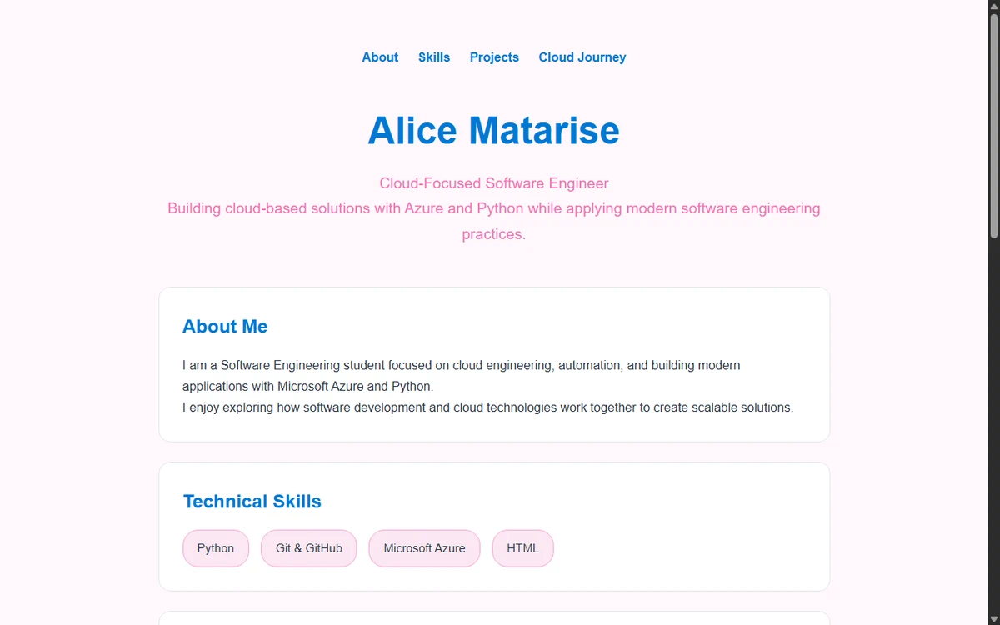<br>
      <sub><strong>Before · Phase 1 Azure Static Website (Commit <code>d1433c2</code>):</strong> Original dark-blue developer resume hosted in an Azure Storage <code>$web</code> container with an HTTP-triggered Azure Function and Azure Table Storage.</sub>
    </td>
    <td width="52%" align="center" valign="top">
      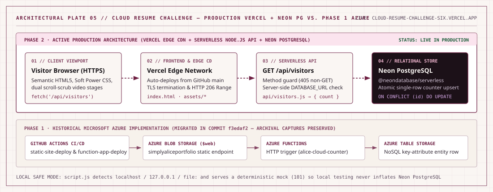<br>
      <sub><strong>After · Phase 2 Soft Power Serverless Architecture:</strong> Active production pipeline on Vercel Edge CDN, <code>api/visitors.js</code>, and Neon PostgreSQL atomic upserts (compared interactively via a live range slider on the website).</sub>
    </td>
  </tr>
</table>

<details>
  <summary><strong>Inspect Original Phase 1 Microsoft Azure &amp; GitHub Actions Deployment Evidence (7 Captures)</strong></summary>
  <br>
  <table>
    <tr>
      <td width="33%" align="center" valign="top">
        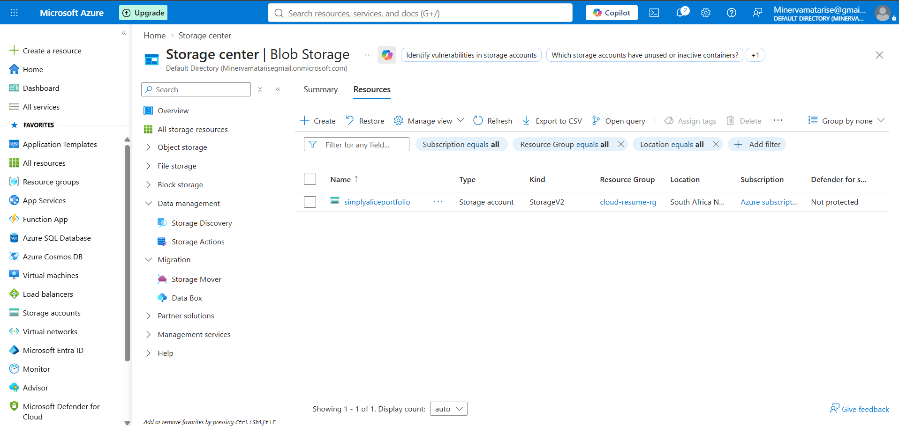<br>
        <sub><strong>01 · Azure Storage Account</strong><br><code>simplyaliceportfolio</code> provisioning</sub>
      </td>
      <td width="33%" align="center" valign="top">
        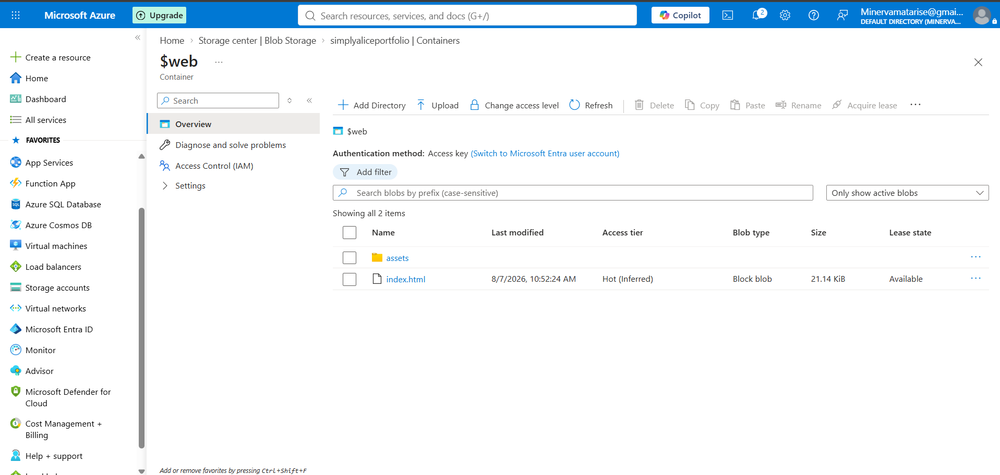<br>
        <sub><strong>02 · Blob <code>$web</code> Container</strong><br>Static website hosting root</sub>
      </td>
      <td width="34%" align="center" valign="top">
        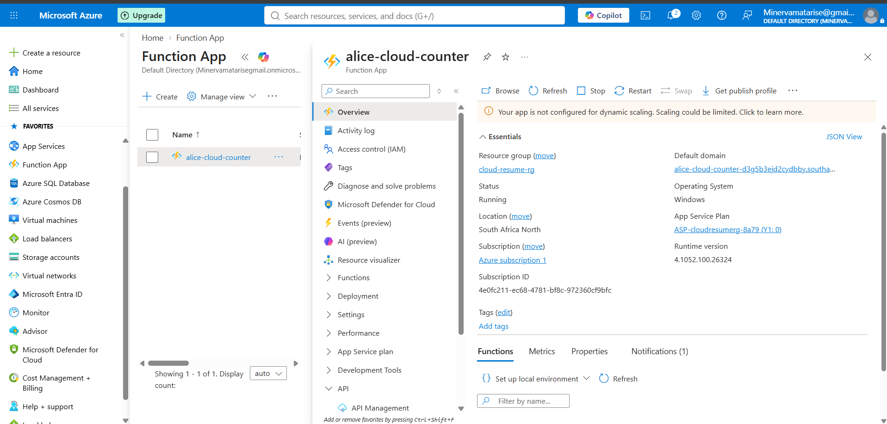<br>
        <sub><strong>03 · Azure Function App</strong><br><code>alice-cloud-counter</code> serverless host</sub>
      </td>
    </tr>
    <tr>
      <td width="33%" align="center" valign="top">
        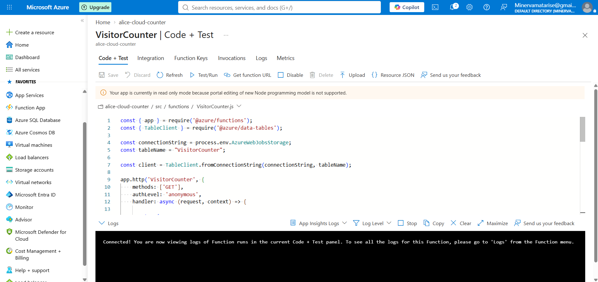<br>
        <sub><strong>04 · HTTP Trigger Function</strong><br>Serverless visitor counter endpoint</sub>
      </td>
      <td width="33%" align="center" valign="top">
        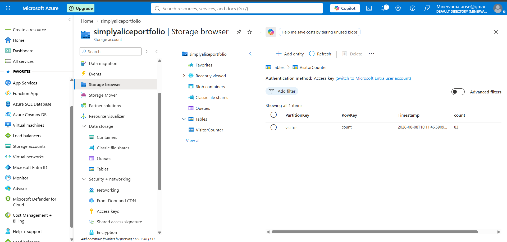<br>
        <sub><strong>05 · Azure Table Storage</strong><br>NoSQL key-attribute counter row</sub>
      </td>
      <td width="34%" align="center" valign="top">
        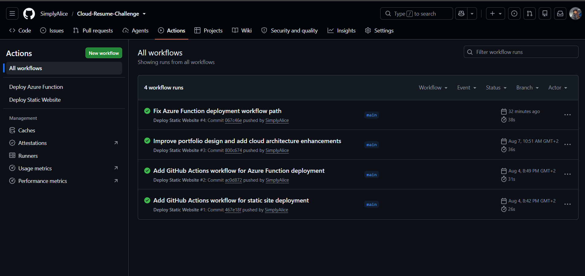<br>
        <sub><strong>06 · GitHub Actions Static CI/CD</strong><br><code>static-site-deploy.yml</code> workflow</sub>
      </td>
    </tr>
    <tr>
      <td colspan="3" align="center" valign="top">
        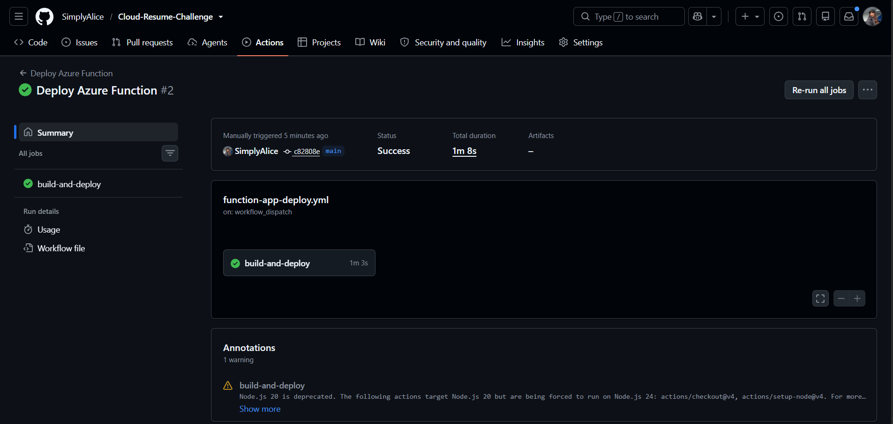<br>
        <sub><strong>07 · GitHub Actions Function CI/CD</strong><br><code>function-app-deploy.yml</code> serverless deployment verification</sub>
      </td>
    </tr>
  </table>
</details>

---

## Production Cloud Architecture

<div align="center">
  
</div>

### End-to-End Request &amp; Persistence Lifecycle

```text
Visitor Browser (HTTPS)
  └──► Vercel Edge Network (index.html, assets/css/styles.css, assets/js/script.js, HTTP 206 MP4 Range streams)
         └──► GET /api/visitors (api/visitors.js — Node.js Serverless Function on Vercel)
                └──► @neondatabase/serverless (Server-side DATABASE_URL over TLS)
                       └──► Neon PostgreSQL (visitor_counter atomic ON CONFLICT DO UPDATE)
```

1. **Frontend Hosting &amp; Edge Delivery (`Vercel`):**
   - Pushing to the `main` branch on GitHub automatically deploys the static frontend (`index.html`, `assets/css/styles.css`, `assets/js/script.js`, WebP/SVG plates, and all-intra `.mp4` scrub assets) to Vercel's global Edge CDN with automatic HTTPS/TLS termination and `HTTP 206 Partial Content` byte-range streaming for smooth video scrubbing.
2. **Serverless Visitor API ([`api/visitors.js`](api/visitors.js)):**
   - Exposes `GET /api/visitors` as a Vercel Node.js Serverless Function.
   - Rejects non-`GET` requests immediately with `HTTP 405 Method Not Allowed` (`{ "error": "Method not allowed" }`).
   - Validates that `process.env.DATABASE_URL` is present server-side before attempting a connection, returning a clean `HTTP 500` (`{ "error": "Database is not configured" }`) rather than leaking stack traces or connection details.
3. **Relational Persistence &amp; Atomic Counter Update (`Neon Serverless PostgreSQL`):**
   - Connects via `@neondatabase/serverless` and executes a single-statement atomic PostgreSQL upsert so concurrent page loads never suffer from read-modify-write race conditions:
   ```sql
   INSERT INTO visitor_counter (id, count)
   VALUES (1, 1)
   ON CONFLICT (id)
   DO UPDATE SET count = visitor_counter.count + 1
   RETURNING count;
   ```
4. **Client Telemetry &amp; Local Loopback Protection ([`assets/js/script.js`](assets/js/script.js)):**
   - In production, `updateCounter()` requests `GET /api/visitors`, measures round-trip latency, and updates the live counter displays (`#hero-visitors`, `#dossier-visitors`, `#visitor-count`).
   - On local preview hosts (`localhost`, `127.0.0.1`, `::1`, `file:`), `isLocalPreviewEnvironment()` returns a deterministic local mock (`101`) by default so development reloads and automated browser tests never inflate the production Neon database.

---

## Technical Skills

Only technologies actively used across my repositories, university coursework, or current cloud training are listed below.

| Discipline | Technologies &amp; Capabilities |
| :--- | :--- |
| **Cloud and Infrastructure** | **Microsoft Azure** (Blob Storage `$web`, Azure Functions, Table Storage, DNS, CDN, RBAC; active **AZ-900** study, **AZ-104** planned next) · **Amazon Web Services** (S3, EC2, Security Groups, Shared Responsibility Model — *AWS Skills Center Cape Town*, Sep 2026) · **Vercel** (Edge CDN &amp; Serverless Functions) · **Neon Serverless PostgreSQL** · **Firebase** (Authentication &amp; Cloud Firestore `firestore.rules`) · **Alwaysdata** (Linux Apache Hosting) |
| **Programming** | **Python** (`3.11–3.13`) · **SQL** · **PHP 8** · **TypeScript** · **JavaScript** (`ES6+`) · **Kotlin** (`Android API 24–37`) · **HTML5 &amp; Modern CSS** · **PowerShell 7** (`7.6.9`) |
| **Backend and APIs** | **FastAPI** (async REST routers, dependency injection) · **SQLAlchemy 2.0** (ORM &amp; `asyncpg`) · **Alembic** (schema migrations) · **Pydantic v2** (`ExactDecimal` financial validation) · **PHP PDO** (prepared statements, transactional locking) · **Node.js Serverless Handlers** · **Retrofit 2 &amp; Gson** · **Argon2, bcrypt, JWT &amp; CSRF security** |
| **Databases** | **PostgreSQL 15 &amp; 16** (`NUMERIC` precision, composite foreign keys, partial unique indexes, `COLLATE "C"`, trigram matching) · **MariaDB / MySQL** (`InnoDB` 3NF schema design, `SELECT ... FOR UPDATE` row locking) · **Cloud Firestore** (NoSQL document modeling &amp; security rules) · **Redis 7** (TTL caching) · **Azure Table Storage** |
| **DevOps and Automation** | **Git &amp; GitHub** (branch governance, PR workflows) · **GitHub Actions CI/CD** · **Docker &amp; Docker Compose** · **SSH/SCP Production Rollouts** · **SHA-256 Asset Parity Verification** (`Get-FileHash`) · **HTTP Header &amp; Cache-Busting Diagnostics** |
| **Development Tools** | **Pytest** · **JUnit 4** · **Vitest** · **Node.js Test Runner (`node:test`)** · **Ruff** · **Android Studio &amp; Gradle** · **Linux CLI** · **Oh My Posh &amp; PSReadLine** (custom Soft Power PowerShell profile) · **Chrome DevTools** |

---

## Engineering Decisions &amp; Lessons Learned

1. **Migrating from Phase 1 Azure to Vercel + Neon PostgreSQL:**
   - Building Phase 1 on Azure Storage (`$web`), Azure Functions, and Azure Table Storage taught me manual cloud resource provisioning, storage container permissions, and split CI/CD workflows (`static-site-deploy.yml` and `function-app-deploy.yml`).
   - Migrating active production to Vercel and Neon Serverless PostgreSQL unified static edge delivery and serverless API routing under a single Git-driven deployment pipeline while eliminating subscription cost friction and cold-start overhead.
2. **Choosing Neon Serverless PostgreSQL for Persistent Visitor Counting:**
   - Moving from a NoSQL key-value entity in Azure Table Storage to PostgreSQL enabled strict relational constraints and native single-statement atomic upserts (`ON CONFLICT (id) DO UPDATE`) over HTTP/WebSockets via `@neondatabase/serverless`.
3. **Keeping Database Credentials Strictly Server-Side:**
   - The browser only ever communicates with the same-origin `/api/visitors` route. `DATABASE_URL` lives exclusively in Vercel's encrypted environment configuration and gitignored local `.env.local` files, preventing credential exposure in client bundles or git history.
4. **Protecting Production Telemetry from Local &amp; Automated Test Traffic:**
   - Automated browser verification reloads pages dozens of times. Guarding `updateCounter()` with `isLocalPreviewEnvironment()` ensures `localhost` and `127.0.0.1` use a deterministic mock (`101`) while production visitors hit Neon PostgreSQL (with `?live_visitors=1` available when explicitly testing the live endpoint locally).
5. **Restructuring Two Videos into Independent Scroll-Scrubbed Experiences:**
   - Combining two different videos into one continuous timeline diluted their visual pacing. Separating them into **Study I (`#video-one`, Deep Plum Studio)** and **Study II (`#video-two`, Warm Parchment Right-Side Split-Screen)** — with Wave I project case studies in between and all-intra (`-g 1 -bf 0`) keyframe encoding — eliminated frame-seeking lag and gave each study a distinct narrative role.
6. **Designing for Reduced Motion, Keyboard Navigation &amp; Screen Readers:**
   - Scroll-scrubbed videos and looping GIFs can cause visual fatigue. When `prefers-reduced-motion: reduce` is active, both video stages lock onto high-resolution static WebP plates (`data-video-state="reduced-motion"`) and all animated project GIFs initialize paused on static WebP posters alongside keyboard-accessible WCAG 2.2.2 **Pause / Play animation** toggles.

---

## Repository Structure &amp; Local Verification

```text
.
├── api/
│   └── visitors.js                 # Vercel Node.js serverless visitor counter endpoint (Neon PostgreSQL)
├── assets/
│   ├── asset-manifest.json         # Complete inventory of editorial, poster, project, and video assets
│   ├── css/styles.css              # Soft Power editorial design system & responsive layouts
│   ├── documents/                  # ATS-friendly HTML CV & downloadable PDF
│   ├── images/
│   │   ├── editorial/              # Botanical & architectural vellum editorial plates (WebP)
│   │   ├── posters/                # Static open/close WebP plates for Study I & Study II
│   │   ├── projects/               # Walkthrough GIFs, posters, app screens & SVG architecture plates
│   │   └── screenshots/            # Original Phase 1 Azure Portal & GitHub Actions captures
│   ├── js/script.js                # Visitor telemetry, independent video scrubbers, ARIA tabs & widgets
│   └── video/                      # Original MP4s, all-intra 1080p/720p scrub derivatives & manifest.json
├── tests/
│   └── portfolio.test.js           # Automated Node.js unit & asset integrity test suite (8 tests)
├── index.html                      # Soft Power engineering portfolio & Cloud Resume Challenge dossier
├── package.json
└── README.md
```

Run syntax verification and the automated Node.js test suite (`node:test`) locally:

```bash
npm run check     # Syntax-check script.js, api/visitors.js, and tests/portfolio.test.js
npm test          # Run the 8-test Node.js verification suite
npm run verify    # Execute both syntax checks and automated tests
```

---

## Portfolio &amp; Contact

I am based in **Cape Town, South Africa** and open to early-career opportunities in **Cloud Support**, **Junior Cloud Engineering**, **Technical Operations**, and **Graduate Software Engineering** (Cape Town hybrid or remote).

- **Live Portfolio:** [https://cloud-resume-challenge-six.vercel.app/](https://cloud-resume-challenge-six.vercel.app/)
- **GitHub Profile:** [https://github.com/SimplyAlice](https://github.com/SimplyAlice)
- **LinkedIn:** [https://www.linkedin.com/in/alice-matarise-778bb6374/](https://www.linkedin.com/in/alice-matarise-778bb6374/)
- **Email:** [Minervamatarise@gmail.com](mailto:Minervamatarise@gmail.com)
- **Curriculum Vitae:** [Download `Alice-Matarise-CV.pdf`](assets/documents/Alice-Matarise-CV.pdf)
